# mic2pc

**mic2pc** is a high-performance, ultra-low-latency virtual microphone system designed to turn an Android device into a studio-grade PC microphone over local UDP. Built specifically for competitive gaming (e.g., CS2, Valorant, Apex Legends) and Discord voice communication, it bridges mobile audio hardware directly into Windows audio endpoints with sub-frame processing overhead.

---

## Architectural Overview

The system consists of two decoupled components: a lightweight Android capture engine and a Windows desktop receiver interfacing with virtual audio driver inputs.

```mermaid
flowchart LR
    subgraph Mobile["Android Client (mic2pc)"]
        direction TB
        MIC["AudioRecord (48 kHz 16-bit PCM Mono)"]
        PACKET["M2 Header Assembly (Seq + Timestamp)"]
        UDP_TX["DatagramSocket (10 ms Frame)"]
        MIC --> PACKET --> UDP_TX
    end

    subgraph Network["Transport Layer"]
        WIFI["Wi-Fi 5 GHz (~15-25 ms)"]
        USB["USB Tethering (~1-3 ms, 0% Loss)"]
    end

    subgraph Desktop["Windows Receiver (PC)"]
        direction TB
        UDP_RX["NetworkReceiver (UDP :50005)"]
        JITTER["Adaptive Ring Buffer (20-30 ms)"]
        AUDIO_ENGINE["SoundDevice WASAPI Engine"]
        VIRTUAL_IN["VB-CABLE Driver (CABLE Input)"]
        UDP_RX --> JITTER --> AUDIO_ENGINE --> VIRTUAL_IN
    end

    subgraph Consumers["Host Applications"]
        DISCORD["Discord (Input: CABLE Output)"]
        GAMES["In-Game Voice (Input: CABLE Output)"]
    end

    UDP_TX --> WIFI & USB
    WIFI & USB --> UDP_RX
    VIRTUAL_IN --> DISCORD & GAMES
```



---

## Technical Specifications

| Parameter | Specification |
| :--- | :--- |
| Audio Encoding | Linear PCM (16-bit signed integer, Little-Endian) |
| Sampling Rate | 48,000 Hz |
| Channels | 1 (Mono hardware capture, dual-channel virtual mapping) |
| Frame Interval | 10 ms (480 samples / 960 bytes payload) |
| Transport Protocol | Datagram (UDP) with custom 14-byte sequencing header |
| Jitter Compensation | Adaptive Ring Buffer with overrun discard & underrun suppression |
| Windows Host Audio API | Windows Audio Session API (WASAPI) Low-Latency stream |

---

## Directory Structure

```text
mic2pc/
|-- .github/workflows/
|   `-- build-apk.yml               # Automated cloud CI/CD APK builder
|-- android-app/                    # Android client source tree (Kotlin)
|   |-- app/
|   |   |-- src/main/java/com/mic2pc/app/
|   |   |   |-- MainActivity.kt         # Runtime UI and permission management
|   |   |   |-- AudioStreamerService.kt # Foreground service with persistent WakeLock
|   |   |   |-- AudioCaptureEngine.kt   # Low-level 48 kHz AudioRecord handler
|   |   |   `-- UdpAudioSender.kt       # DatagramSocket serializer
|   |   `-- src/main/res/               # Vector assets, themes, and layouts
|   `-- build.gradle.kts
|-- pc-receiver/                    # Windows receiver source tree (Python)
|   |-- audio_engine.py             # WASAPI output stream & adaptive jitter buffer
|   |-- network_receiver.py         # Non-blocking UDP receiver & metric calculation
|   |-- ui.py                       # Modern desktop interface and system tray
|   |-- main.py                     # Application entrypoint
|   |-- requirements.txt            # Python dependencies
|   `-- mic2pc.vbs                  # Windowless direct launcher
|-- mic2pc.vbs                      # Root-level silent desktop launcher
`-- README.md                       # System documentation
```

---

## Prerequisites

1. **VB-Audio Virtual Cable (Windows)**:
   - A virtual audio device is required to present the received audio stream as a microphone device to Discord and games.
   - Download and install the driver from the official vendor: [https://vb-audio.com/Cable/](https://vb-audio.com/Cable/)
   - Reboot Windows after driver installation.

2. **Python Environment (PC)**:
   - Python 3.10 or higher.
   - Dependencies: `sounddevice`, `numpy`, `customtkinter`, `pystray`, `pillow`.

---

## Quick Start Guide

### 1. Launching the PC Receiver
Double-click `mic2pc.vbs` located in the root directory. 

*Note: `mic2pc.vbs` launches the application directly in background mode without spawning an intrusive command prompt (CMD) window.*

- In the application window:
  - Verify **Output Audio Device** is set to `CABLE Input (VB-Audio Virtual Cable)`.
  - Set **Jitter Buffer** to `25 ms` (default).
  - Click **Start Service**.
  - Note the local IP address displayed at the top (e.g., `192.168.1.34`).

### 2. Installing the Android Application
The Android client is continuously built via GitHub Actions CI/CD.

- Navigate to the **Actions** tab in this repository.
- Select the latest workflow run on the `main` branch.
- Scroll down to the **Artifacts** section and download `mic2pc-android-apk`.
- Extract the ZIP archive and install `app-debug.apk` onto your Android device.

Alternatively, open the `android-app` folder directly in Android Studio and build to device.

### 3. Establishing Audio Stream
- Open **mic2pc** on your Android device.
- Grant microphone and notification permissions when prompted.
- Enter the PC IP address and port (`50005`).
- Tap **Start Stream**. The VU meter will immediately reflect your voice input.

### 4. Discord and In-Game Configuration
To route the phone microphone into applications:
- **Discord**: Navigate to `User Settings > Voice & Video`.
  - Set **Input Device** to `CABLE Output (VB-Audio Virtual Cable)`.
  - Set **Output Device** to your physical headphones.
- **In-Game Voice**: Select `CABLE Output` as your default recording device in Windows Sound Control Panel.

---

## Protocol Specification

Each datagram packet begins with a fixed 14-byte header followed by raw PCM samples:

```text
 0                   1                   2                   3
 0 1 2 3 4 5 6 7 8 9 0 1 2 3 4 5 6 7 8 9 0 1 2 3 4 5 6 7 8 9 0 1
+-+-+-+-+-+-+-+-+-+-+-+-+-+-+-+-+-+-+-+-+-+-+-+-+-+-+-+-+-+-+-+-+
|       Magic: 'M' '2'          |       Sequence Number         |
+-+-+-+-+-+-+-+-+-+-+-+-+-+-+-+-+-+-+-+-+-+-+-+-+-+-+-+-+-+-+-+-+
|  Sequence Number (Continued)  |      Client Timestamp         |
+-+-+-+-+-+-+-+-+-+-+-+-+-+-+-+-+-+-+-+-+-+-+-+-+-+-+-+-+-+-+-+-+
|                  Client Timestamp (Continued)                 |
+-+-+-+-+-+-+-+-+-+-+-+-+-+-+-+-+-+-+-+-+-+-+-+-+-+-+-+-+-+-+-+-+
|                     Raw Linear PCM Samples                    |
|                (480 samples, 16-bit, Little-Endian)           |
|                               ...                             |
+-+-+-+-+-+-+-+-+-+-+-+-+-+-+-+-+-+-+-+-+-+-+-+-+-+-+-+-+-+-+-+-+
```

Total packet size is **974 bytes**, well below standard Ethernet and 802.11 MTU boundaries (1500 bytes), avoiding IP fragmentation entirely.

---

## Connection Performance Profiles

| Interface | Average Latency | Packet Loss | Recommended Usage |
| :--- | :--- | :--- | :--- |
| **USB Tethering** | **1 - 3 ms** | 0.0% | Competitive FPS tournaments and zero-delay broadcast |
| **5 GHz Wi-Fi** | **15 - 25 ms** | < 0.2% | Wire-free gaming and voice communication |
| **2.4 GHz Wi-Fi** | **35 - 60 ms** | 1.0 - 3.0% | General communication (increase buffer to 40 ms) |

### Optimal Setup: USB Tethering
For competitive esports requiring negligible latency:
1. Connect phone via USB cable to PC.
2. Enable **USB Tethering** in Android Network settings.
3. A local RNDIS network interface will initialize on the PC (typically `192.168.42.x`).
4. Enter this subnet IP into the mobile application.

---

## Firewall Troubleshooting

If the PC receiver remains on `WAITING` status after starting the stream:
1. Open Windows Defender Firewall with Advanced Security.
2. Create an **Inbound Rule**:
   - Rule Type: **Port**
   - Protocol: **UDP**
   - Specific Local Ports: **50005**
   - Action: **Allow the connection**
3. Alternatively, allow `pythonw.exe` through private and public network profiles.

---

## License

This project is licensed under the Apache License 2.0. See the LICENSE file for details.
