# mic2pc

**mic2pc** is a high-performance, ultra-low-latency virtual microphone system that converts an Android device into a studio-grade PC microphone over local UDP. Designed with a clean **Material Design 3 (Material You)** interface inspired by modern open-source desktop clients (such as LocalSend), it bridges mobile audio hardware directly into Windows audio endpoints with sub-frame processing overhead.

---

## Architectural Overview

```mermaid
flowchart LR
    subgraph Mobile["Android Client (Material 3)"]
        direction TB
        MIC["AudioRecord (48 kHz 16-bit PCM Mono)"]
        GAIN["Software Gain Booster (1.0x - 2.5x)"]
        PACKET["M2 Header Assembly (Seq + Timestamp)"]
        UDP_TX["DatagramSocket (10 ms Frame)"]
        MIC --> GAIN --> PACKET --> UDP_TX
    end

    subgraph Network["Transport Layer"]
        WIFI["Wi-Fi 5 GHz (~15-25 ms)"]
        USB["USB Tethering (~1-3 ms, 0% Loss)"]
    end

    subgraph Desktop["Windows Receiver (NavigationRail M3)"]
        direction TB
        UDP_RX["NetworkReceiver (Clock-Skew Filtered UDP :50005)"]
        JITTER["Adaptive Ring Buffer (20-30 ms)"]
        PC_GAIN["Digital Gain Booster (0.5x - 3.0x)"]
        AUDIO_ENGINE["SoundDevice WASAPI Engine"]
        VIRTUAL_IN["VB-CABLE Driver (CABLE Input)"]
        UDP_RX --> JITTER --> PC_GAIN --> AUDIO_ENGINE --> VIRTUAL_IN
    end

    subgraph Consumers["Host Applications"]
        DISCORD["Discord (Input: CABLE Output)"]
        GAMES["In-Game Voice (Input: CABLE Output)"]
    end

    UDP_TX --> WIFI & USB
    WIFI & USB --> UDP_RX
    VIRTUAL_IN --> DISCORD & GAMES
```



---

## Key Features

- **Material Design 3 Architecture**:
  - **Desktop (PC)**: NavigationRail layout featuring dedicated **Stream**, **Diagnostics**, and **Settings** tabs with 5 customizable M3 color schemes (Lavender, Sapphire, Mint, Sunset, Rose).
  - **Mobile (Android)**: M3 Bottom Navigation Bar with live telemetry, adaptive themes, audio source selection, and quick gain toggles.
- **Hardware Noise Suppression vs. Studio Mode**:
  - `Voice Communication Mode`: Activates hardware-level acoustic echo cancellation (AEC) and background noise suppression for clean Discord/gaming comms.
  - `Raw Studio Mode`: Unprocessed audio capture preserving full dynamic range.
- **Bi-Directional Digital Gain Booster**:
  - Independent gain amplification on both phone (up to 2.5x) and PC (up to 3.0x) to eliminate quiet mobile microphone output.
- **Clock-Skew Normalization**:
  - Real-time offset calibration eliminates artificial wall-clock desync between phone and PC, reporting true physical network latency (10-25 ms).
- **Permanent Firewall Configuration**:
  - Includes a one-click automated helper script (`fix_firewall.bat`) to bind an inbound UDP rule on port `50005`, eliminating repetitive Windows Defender elevation dialogs.
- **Zero-Dependency Executable**:
  - Portable standalone binary (`mic2pc.exe`) bundling runtime dependencies, WASAPI drivers, and desktop tray controls into a single windowless package.

---

## Technical Specifications

| Parameter | Specification |
| :--- | :--- |
| Audio Encoding | Linear PCM (16-bit signed integer, Little-Endian) |
| Sampling Rate | 48,000 Hz |
| Channels | 1 (Mono hardware capture, dual-channel virtual mapping) |
| Frame Interval | 10 ms (480 samples / 960 bytes payload) |
| Transport Protocol | Datagram (UDP) with custom 14-byte sequencing header |
| Jitter Compensation | Adaptive Ring Buffer with overrun discard & underrun suppression |
| Windows Host Audio API | Windows Audio Session API (WASAPI) Low-Latency stream |

---

## Directory Structure

```text
mic2pc/
|-- .github/workflows/
|   `-- build-apk.yml               # Automated cloud CI/CD APK builder
|-- android-app/                    # Android client source tree (Kotlin)
|   |-- app/
|   |   |-- src/main/java/com/mic2pc/app/
|   |   |   |-- MainActivity.kt         # M3 navigation, theme, and control bindings
|   |   |   |-- AudioStreamerService.kt # Foreground service with persistent WakeLock
|   |   |   |-- AudioCaptureEngine.kt   # Low-level 48 kHz AudioRecord handler & gain
|   |   |   `-- UdpAudioSender.kt       # DatagramSocket serializer
|   |   `-- src/main/res/               # M3 layouts, drawables, and color tokens
|   `-- build.gradle.kts
|-- pc-receiver/                    # Windows receiver source tree (Python)
|   |-- audio_engine.py             # WASAPI output stream, gain booster, and jitter buffer
|   |-- network_receiver.py         # UDP receiver with clock-skew latency filter
|   |-- ui.py                       # LocalSend-style NavigationRail M3 interface
|   |-- main.py                     # Application entrypoint
|   |-- requirements.txt            # Python dependencies
|   `-- scripts/
|       |-- build_exe.bat           # Executable compilation script
|       `-- tests/                  # Audio pipeline verification scripts
|-- fix_firewall.bat                # One-click permanent firewall authorization
|-- mic2pc.exe                      # Standalone windowless executable
`-- README.md                       # System documentation
```

---

## Installation & Quick Start

### 1. Prerequisites
- **VB-Audio Virtual Cable (Windows)**:
  - Required to route audio into Discord and games.
  - Download and install: [https://vb-audio.com/Cable/](https://vb-audio.com/Cable/)
  - Reboot Windows after installation.
- **Firewall Authorization**:
  - Run `fix_firewall.bat` as Administrator once to register an inbound rule for port 50005.

### 2. Launching the PC Receiver
Run `mic2pc.exe` in the root folder.
- Under **Audio Output Device**, select `CABLE Input (VB-Audio Virtual Cable)`.
- Click **Start Service**.
- Note the displayed local IP address (e.g., `192.168.1.34`).

### 3. Installing the Android Client
- Download the latest APK artifact from the **Actions** tab on GitHub (`mic2pc-android-apk`).
- Install `app-debug.apk` onto your device.
- Enter the PC IP and tap **Start Stream**.

### 4. Discord and In-Game Setup
- **Discord**: Go to `User Settings > Voice & Video`.
  - Set **Input Device** to `CABLE Output (VB-Audio Virtual Cable)`.
  - Set **Output Device** to your physical headset.

---

## Connection Profiles

| Interface | Average Latency | Packet Loss | Recommended Usage |
| :--- | :--- | :--- | :--- |
| **USB Tethering** | **1 - 3 ms** | 0.0% | Tournament gameplay and zero-latency broadcast |
| **5 GHz Wi-Fi** | **15 - 25 ms** | < 0.2% | Wire-free gaming and voice communication |
| **2.4 GHz Wi-Fi** | **35 - 60 ms** | 1.0 - 3.0% | Casual calls (set buffer to 40 ms) |

---

## License

This project is licensed under the Apache License 2.0. See the LICENSE file for details.
