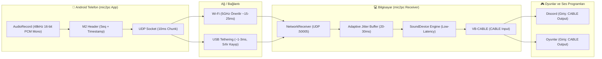

# mic2pc

**mic2pc**, Android telefonunuzu bilgisayarınıza **ultra düşük gecikmeli (low-latency)** bir mikrofona dönüştüren iki parçalı açık kaynaklı bir sistemdir. Rekabetçi oyunlarda (CS2, Valorant, Rainbow Six Siege vb.) ve Discord sesli sohbetlerinde kristal netliğinde ve sıfıra yakın gecikmeyle kullanılmak üzere tasarlanmıştır.

---

## Mimari ve Çalışma Mantığı



---

## Proje Dizin Yapısı

```text
mic2pc/
├── pc-receiver/                      # Bilgisayar Alıcı Uygulaması (Python)
│   ├── venv/                         # Python Sanal Ortamı
│   ├── requirements.txt              # Gerekli kütüphaneler (sounddevice, customtkinter vb.)
│   ├── main.py                       # Giriş noktası
│   ├── ui.py                         # Modern Dark-Mode GUI ve Sistem Tepsisi
│   ├── audio_engine.py               # Low-latency ses motoru & Jitter Buffer
│   ├── network_receiver.py           # UDP dinleyici, seq kontrolü & latency hesabı
│   ├── start_receiver.bat            # Tek tıkla başlatma betiği
│   └── scripts/
│       └── setup_usb_forward.bat     # USB / ADB bağlantı rehberi
│
├── android-app/                      # Android Mobil Uygulama (Kotlin)
│   ├── app/
│   │   ├── build.gradle.kts
│   │   └── src/main/
│   │       ├── AndroidManifest.xml   # İzinler ve Foreground Service tanımları
│   │       ├── java/com/mic2pc/app/
│   │       │   ├── MainActivity.kt        # Modern Arayüz & İzin Yönetimi
│   │       │   ├── AudioStreamerService.kt# Arka Planda Kesintisiz Yayın Servisi
│   │       │   ├── AudioCaptureEngine.kt  # 48kHz Donanım Düzeyi PCM Yakalama
│   │       │   └── UdpAudioSender.kt      # UDP Soket & M2 Başlık Gönderici
│   │       └── res/                       # UI Tasarımı (VU Meter, Dark Theme vb.)
│   ├── build.gradle.kts
│   ├── settings.gradle.kts
│   └── gradle.properties
└── README.md
```

---

## Kurulum Adımları

### 1. VB-CABLE Sanal Ses Kablosunu Kurma (Zorunlu)
Windows'un telefonunuzu gerçek bir mikrofon olarak algılaması için ücretsiz bir sanal ses kablosu gereklidir:
1. [VB-Audio Cable Resmi Sitesinden](https://vb-audio.com/Cable/) ücretsiz indirin.
2. ZIP'i çıkartıp `VBCABLE_Setup_x64.exe` dosyasına sağ tıklayıp **Yönetici Olarak Çalıştır**'ı seçin.
3. Kurulum tamamlandığında bilgisayarınızı yeniden başlatın.

---

### 2. PC Alıcı Uygulamasını Çalıştırma
1. `pc-receiver` klasöründeki `start_receiver.bat` dosyasına çift tıklayın.
   *(Gerekli tüm Python ortamı otomatik olarak hazırlanır ve modern arayüz açılır).*
2. Arayüzde:
   - **Ses Çıkış Aygıtı**: Listeden `CABLE Input (VB-Audio Virtual Cable)` seçeneğini seçin.
   - **Jitter Buffer**: Varsayılan `25 ms` bırakın (iyi bir yerel ağda 15-25ms harika çalışır).
   - **Hizmeti Başlat** butonuna tıklayın.
   - Üst kısımda yazan **PC Yerel IP** adresinizi not edin (Örn: `192.168.1.34`).

---

### 3. Mobil Uygulamayı (Android) Telefona Yükleme
1. **Android Studio**'yu açın.
2. `Open` seçeneğiyle `mic2pc/android-app` klasörünü seçin.
3. Telefonunuzu USB hata ayıklama ile bağlayın ve yeşil **Run (Çalıştır)** butonuna basın (veya `Build > Build APK(s)` ile APK oluşturup telefonunuza atın).
4. Uygulamayı açtığınızda:
   - Mikrofon iznini onaylayın.
   - PC arayüzünde görünen **PC Yerel IP**'sini ve Portu (`50005`) girin.
   - **Yayını Başlat** butonuna basın. Canlı **VU Meter** yeşil renkte dalgalanacaktır.

---

### 4. Discord ve Oyun Ayarları
Telefonunuzdaki sesin Discord ve oyunlara gitmesi için:
- **Discord Ayarları > Ses ve Görüntü**:
  - **Giriş Aygıtı (Input Device)**: `CABLE Output (VB-Audio Virtual Cable)` seçin.
  - **Çıkış Aygıtı (Output Device)**: Kendi kulaklığınızı seçin.
- **Windows / Steam / Oyun Ses Ayarları**:
  - Varsayılan Giriş (Mikrofon) olarak `CABLE Output` seçin.

---

## Ultra Düşük Gecikme (Low-Latency) Tavsiyeleri

| Bağlantı Türü | Ortalama Gecikme | Önerilen Senaryo |
| :--- | :--- | :--- |
| **USB Tethering (Kablo)** | **1 - 3 ms** | Rekabetçi FPS Oyunları (Sıfır paket kaybı, sıfır jitter) |
| **5 GHz Wi-Fi** | **15 - 25 ms** | Kablosuz Rahatlık, Discord Sohbetleri |
| **2.4 GHz Wi-Fi** | **35 - 60 ms** | Uzak mesafeler (Jitter buffer'ı 35-40ms yapın) |

> [!TIP]
> **En Düşük Gecikme (1-3ms) İçin USB Tethering Yöntemi:**
> Telefonunuzu USB ile PC'ye bağlayıp Android Ayarlarından **USB Bağlantısı (USB Tethering)** özelliğini açın. Telefon ile bilgisayar arasında doğrudan 1 Gbps hızında sanal bir Ethernet köprüsü kurulur. mic2pc PC arayüzünde beliren `192.168.42.x` IP adresini telefona girip bağlandığınızda gecikme fark edilemez seviyeye (1-3ms) iner.

---

## Güvenlik Duvarı İzni (İlk Sefer İçin)
Eğer telefondan yayını başlattığınızda PC'de sayaç artmıyorsa:
- Windows Güvenlik Duvarı açılır penceresinde **Özel ve Ortak ağlarda Python'a izin ver** kutucuklarını işaretleyin.
- Veya Windows Güvenlik Duvarından UDP `50005` portuna izin verin.
